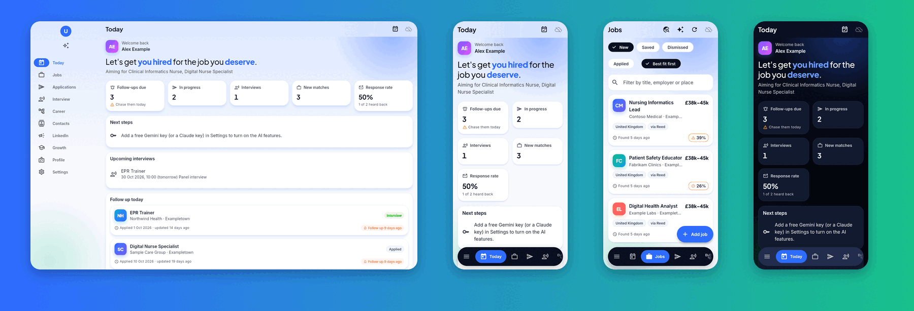
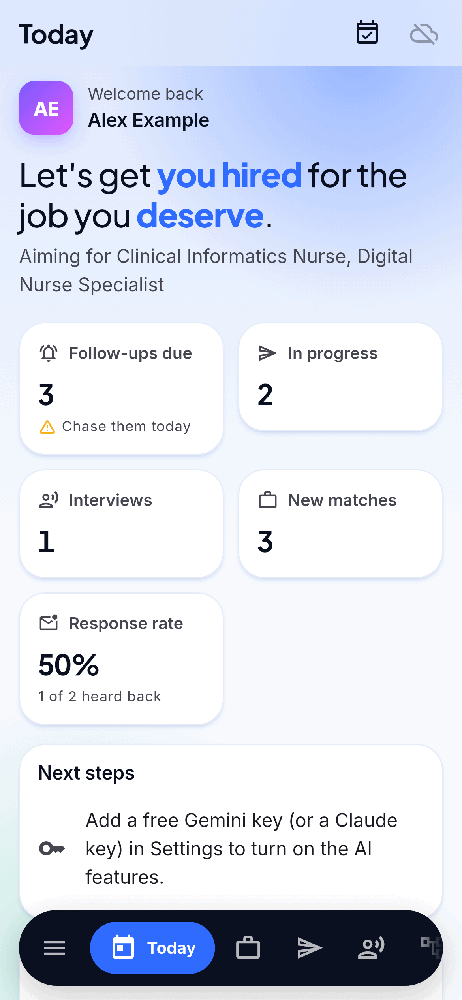
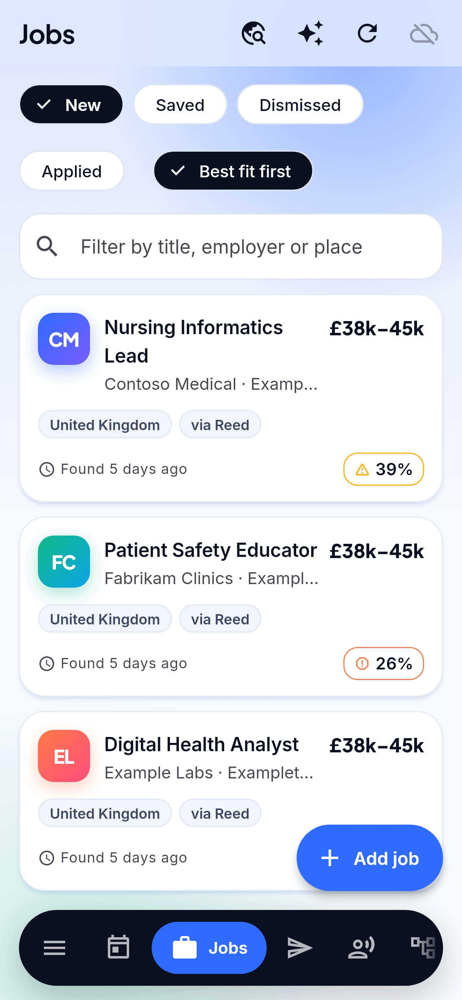
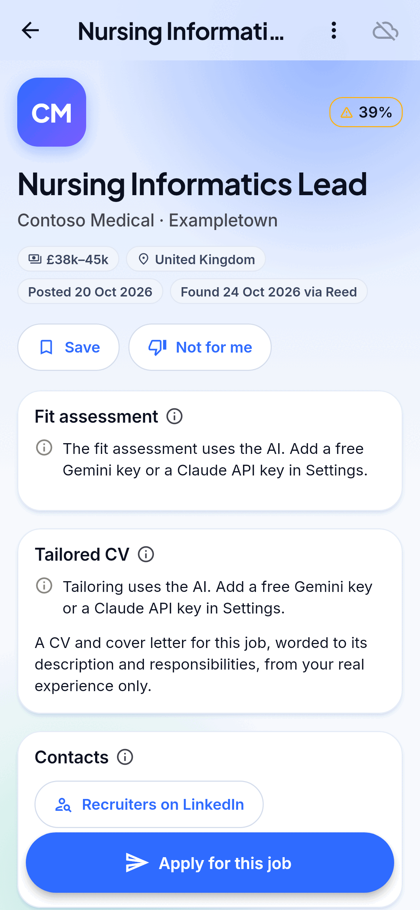
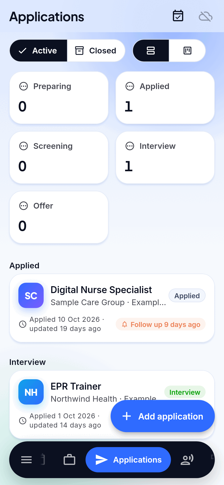
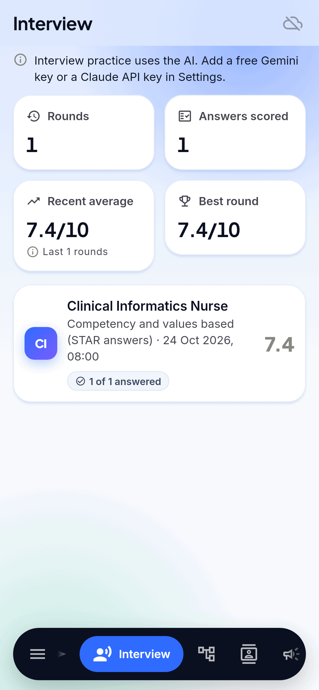
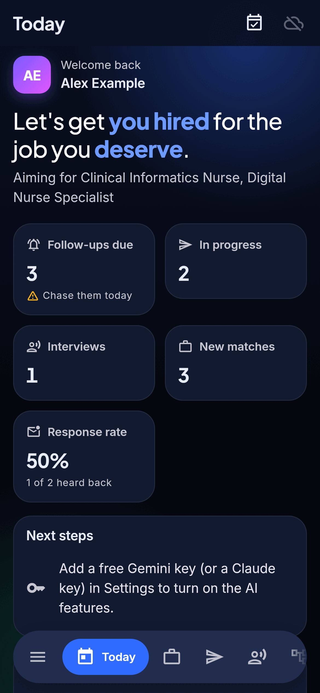
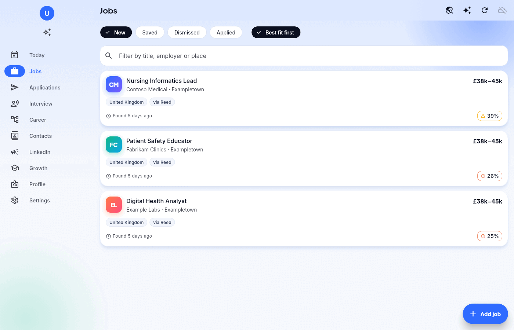
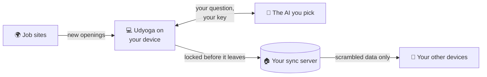

<h1 align="center">
  <br>
  <a href="https://github.com/sudharamachandranrajeev/udyoga"></a>
  <br>
  Udyoga
  <br>
</h1>

<h4 align="center">Find jobs that fit, see honestly where you stand, tailor every application and practise for the interview.</h4>

<p align="center">
  <a href="https://github.com/sudharamachandranrajeev/udyoga/releases"></a>
  
  
  <a href="https://github.com/sudharamachandranrajeev/brahma"></a>
</p>

<p align="center">
  <a href="#-what-it-does">What it does</a> •
  <a href="#-get-started">Get started</a> •
  <a href="#-how-it-works">How it works</a> •
  <a href="#-faq-and-troubleshooting">FAQ</a> •
  <a href="#%EF%B8%8F-for-developers">For developers</a>
</p>

<p align="center">
  
</p>

Udyoga is a career coach and job-search organiser for anyone looking for work or planning their
next move. It finds openings, tells you plainly how well you fit, and keeps every application and
contact on track. Status: **test releases**. The AI features need a free Gemini key, an API key
or a Claude or ChatGPT plan.

## ✨ What it does

- 📄 **A profile from your CV** – import your CV as PDF, .docx or text, and the AI fills in your
  jobs, skills and education. Import several versions and they merge into one.
- 🔍 **Jobs found for you** – openings for your target roles in the countries you choose, from
  free job sites, refreshed every few hours. Duplicates are merged.
- 🎯 **An honest fit score** – every job gets a score. Open it to see what matches, what is
  missing and how to talk about the gaps.
- ✍️ **A CV and cover letter per job** – reworded for one advert from your real experience only,
  with a keyword check (the words hiring software looks for). Export to .docx.
- 📋 **Every application on a board** – one column per stage. Drag a card to move it on.
  Follow-ups come round by themselves, and the AI drafts the chaser.
- 🎤 **Interview practice** – type your answer and see how long it would take to say. Get scores,
  red flags and a stronger answer in your own voice.
- 🧭 **A career map** – a blunt view of where you stand, and five to eight paths from here with
  steps, pay and how AI is changing each one.
- 💼 **LinkedIn helper** – profile score, posts, comments and connection notes, all drafted for
  you to post yourself. Nothing is automated on your account.
- 🔒 **Private by design** – data is encrypted on the device. Sync is optional, and one account
  works in every Brahma app.

<details>
<summary>Full feature list</summary>

| Area | What is included |
| --- | --- |
| Profile | CV import (PDF, .docx, text, up to eight versions merged), target roles, countries, places and ways of working |
| Jobs | Five free job-site feeds, plus an optional AI web search of employer and public-sector sites |
| Fit | Quick score on every job; full verdict with matched requirements, gaps and how serious each is |
| Applications | Preparing, applied, screening, interview, offer, closed; list or board; *No reply* after six weeks; drafted chasers, thank-you notes and feedback requests; reminders to your calendar or an `.ics` file |
| Contacts | Recruiters and hiring managers from public pages or added by you, each with a follow-up date and a drafted first message |
| Interview | Mixed, competency (STAR), technical, toughest panel, and AI and change rounds; live measures of length, speaking time, filler words, "I" against "we", figures and STAR coverage; seven-part AI review |
| Career | Assessment, career map of five to eight paths, redone monthly when the AI routine is on |
| Growth | Certifications, courses and experience to get; *Ideas and wins* notes the AI reads in every request; LinkedIn data import (the ZIP LinkedIn sends you) |
| LinkedIn studio | Eleven tools: profile score and rewrite, posts, comments, connection notes and follow-ups, inbox triage, replies, week plan, post audit, carousel PDF, repurposing; a five-check "sounds human" score |
| Leads (optional) | Your own [n8n](https://n8n.io) workflow finds contacts from public search results: [docs/n8n](docs/n8n/README.md) |
| Updates | Checks for a new release at start, verifies it and installs it after asking |

</details>

## 📸 Screenshots

<table>
  <tr>
    <td align="center"><br><sub>Today</sub></td>
    <td align="center"><br><sub>Jobs</sub></td>
    <td align="center"><br><sub>A job</sub></td>
  </tr>
  <tr>
    <td align="center"><br><sub>Applications</sub></td>
    <td align="center"><br><sub>Interview practice</sub></td>
    <td align="center"><br><sub>Today (dark)</sub></td>
  </tr>
</table>

<p align="center">
  <br>
  <sub>Jobs on a desktop window</sub>
</p>

<sub>All screenshots show a made-up person and made-up companies, rendered from the current code.</sub>

## 🚀 Get started

### Step 1 – Download

Open the [releases page](https://github.com/sudharamachandranrajeev/udyoga/releases) and, under
the newest release, pick the file for your device:

| Your device | File to download | Works on |
| --- | --- | --- |
| 🐧 Linux computer | `Udyoga-<version>-linux-x64.tar.gz` | Ubuntu 24.04, Fedora, Arch and similar (64-bit x86) |
| 🪟 Windows computer | `Udyoga-<version>-windows-x64-setup.exe` | Windows 10 and 11 |
| 🤖 Android phone | `Udyoga-<version>-android.apk` | Android 7 and newer |

Each release also has `SHA256SUMS.txt`, a list of fingerprints to check the files are genuine.

### Step 2 – Install

<details>
<summary><b>🐧 Linux</b></summary>

1. Open a terminal in the folder where the download landed.
2. Unpack it and run the installer as your normal user (not `sudo`):
   ```sh
   tar -xzf Udyoga-*-linux-x64.tar.gz
   cd udyoga-*-linux-x64 && ./install.sh
   ```
3. Open **Udyoga** from your app menu.

It installs for your user only. It needs GTK 3, libsecret and the desktop keyring (the app that
stores passwords) running. To remove it later: `./install.sh --uninstall`. Your data stays.

</details>

<details>
<summary><b>🪟 Windows</b></summary>

1. Double-click `Udyoga-<version>-windows-x64-setup.exe`. No admin rights needed.
2. Windows may say *"Windows protected your PC"*. This appears because the app isn't paid-signed
   yet, not because it is harmful. Click **More info → Run anyway**.
3. Follow the installer, then open **Udyoga** from the Start menu.

Prefer no installer? Download `…-windows-x64-portable.zip`, unzip it anywhere and run `udyoga.exe`.

</details>

<details>
<summary><b>🤖 Android</b></summary>

1. Open the downloaded `.apk` on your phone.
2. If Android asks, allow installs from your browser or file manager. This is normal for apps
   from outside an app store.
3. Tap **Install**, then **Open**.

Newer versions install over the top and keep your data. Udyoga can also update itself from
**Settings → Updates**.

</details>

### Step 3 – First launch

1. **Choose where your data lives.** Pick **Keep everything on this device**, or **Sync across my
   devices** to set up a server (see Step 5). You can change this later in Settings.
2. **Turn on the AI.** Open **Settings → AI** and tap **Get a free Gemini key**. Sign in to
   Google AI Studio, press **Create API key**, and paste it in. A Claude API key works too.
3. **Import your CV.** On **Profile**, tap **Import CVs (PDF or Word)**, or **Paste text**.
   Then set the countries to search in.
4. **Find jobs.** On **Jobs**, tap **Refresh**. Open a job to see your fit and tailor your CV.

**Today** always lists your next steps, so you can follow it from there.

### Step 4 (optional) – Use your Claude or ChatGPT plan

On Linux and Windows, Udyoga can use the AI plan you already pay for instead of an API key.

1. Install [Claude Code](https://code.claude.com/docs/en/setup) and sign in, or install
   [Codex](https://developers.openai.com/codex/cli) and run `codex login`.
2. In Udyoga, open **Settings → AI** and tap **Connect**.

Udyoga never sees your login. Its permission lasts 24 hours, and it asks to renew at the next start.

### Step 5 (optional) – Use it on more than one device

1. Set up a free sync server, at home or on Cloudflare. The
   [Brahma sync server guide](https://github.com/sudharamachandranrajeev/brahma/tree/main/server)
   walks you through it.
2. In Udyoga, choose **Sync across my devices** (at first launch, or in **Settings → Sync**).
3. **Write down the recovery key** it shows and keep it somewhere safe, away from the device.
4. On your next device, choose **Join from a device I already use**.

## 🧭 How it works



- **On each device**, Udyoga keeps your profile, jobs and applications in an encrypted database.
- **Job sites** are asked for openings every few hours while the app is open.
- **The AI** (Gemini, Claude or ChatGPT) gets the text it needs for each task, such as your
  profile and one job advert. Your keys stay in the encrypted settings.
- **LinkedIn** is only opened through its own links and the ZIP you import. Udyoga never signs in
  to it or posts for you.

> [!IMPORTANT]
> Your password and recovery key are the only ways to unlock synced data. If you lose both, nobody
> can recover it. On Android, uninstalling the app deletes its data, so sync first.

## ❓ FAQ and troubleshooting

<details>
<summary><b>Does the AI cost money?</b></summary>

Not with a free Gemini key. A Claude API key is billed by Anthropic; **Settings → AI** shows
roughly what you spent this month. A Claude or ChatGPT plan you already have costs nothing more.
On Google's free tier, prompts may be used to improve Google's products, except in the UK, EEA and
Switzerland.
</details>

<details>
<summary><b>Windows says the app might be unsafe</b></summary>

The build isn't code-signed (a paid certificate). Click **More info → Run anyway**. Check the file
against `SHA256SUMS.txt` on the release if you want to be sure it is genuine.
</details>

<details>
<summary><b>Linux: the app stops at start and talks about a missing key</b></summary>

The key that unlocks your data lives in the desktop keyring. Make sure your keyring app is
running and unlocked, then start Udyoga again.
</details>

<details>
<summary><b>The Jobs page is empty</b></summary>

Import your CV and choose countries on **Profile** first, then tap **Refresh** on **Jobs**. Free
keys for Adzuna and Reed (**Settings → Job sites → Keys**) bring in more openings.
</details>

<details>
<summary><b>Reading my CV with ChatGPT fails</b></summary>

Codex cannot read PDFs here. On **Profile**, tap **Paste text** and paste your CV's text instead.
</details>

<details>
<summary><b>Will LinkedIn ban me?</b></summary>

Udyoga does nothing on LinkedIn for you. It drafts text for you to post or send by hand, and reads
the data file you download yourself. Why it works this way: [docs/n8n](docs/n8n/README.md).
</details>

## 🛠️ For developers

<details>
<summary>Build from source, test and release</summary>

You need [Git](https://git-scm.com) and [Flutter](https://flutter.dev) 3.47.

```bash
git clone https://github.com/sudharamachandranrajeev/udyoga
cd udyoga
flutter pub get
flutter run -d linux        # or windows, or an Android device

flutter analyze && flutter test                                     # check and test
UDYOGA_SHOTS=/tmp/shots flutter test test/screenshots_test.dart     # render the screenshots
scripts/make-icons.sh                                               # app icons from branding/udyoga.svg
```

- `brahma_core` comes from the [brahma](https://github.com/sudharamachandranrajeev/brahma) repo.
  To work on both at once, add a `pubspec_overrides.yaml` (ignored by git) with
  `dependency_overrides: brahma_core: path: ../brahma/core`.
- Tests use made-up people and companies only. CI runs analyse and test on each push. A `v*` tag
  builds, smoke-tests and publishes the Android, Windows and Linux builds
  (`.github/workflows/release.yml`).
- Changes per version: [CHANGELOG.md](CHANGELOG.md). Lead workflow and LinkedIn study:
  [docs/n8n](docs/n8n/README.md).

</details>

<details>
<summary>Credits</summary>

- [Flutter](https://flutter.dev) and [Riverpod](https://riverpod.dev)
- [drift](https://drift.simonbinder.eu) over [SQLite3MultipleCiphers](https://utelle.github.io/SQLite3MultipleCiphers/)
  for the encrypted database
- [http](https://pub.dev/packages/http), [file_picker](https://pub.dev/packages/file_picker),
  [archive](https://pub.dev/packages/archive), [url_launcher](https://pub.dev/packages/url_launcher),
  [intl](https://pub.dev/packages/intl)
- Job data from free public job-site feeds
- Fonts [Inter](https://rsms.me/inter/) and [Plus Jakarta Sans](https://github.com/tokotype/PlusJakartaSans),
  bundled under the SIL Open Font License

</details>

## Related

Udyoga is one app in the **Brahma** family. They share one sign-in and one sync server.

| App | What it does |
| --- | --- |
| [brahma](https://github.com/sudharamachandranrajeev/brahma) | The shared core and the all-in-one app |
| [artha](https://github.com/sudharamachandranrajeev/artha) | Money: accounts, spending, bills and investments |
| [graha-anveshana](https://github.com/sudharamachandranrajeev/graha-anveshana) | Find a home to rent or buy |
| [vahana-anveshana](https://github.com/sudharamachandranrajeev/vahana-anveshana) | Find a car |
| [vidya](https://github.com/sudharamachandranrajeev/vidya) | Learning, flashcards and focus |

## License

No licence has been chosen yet; all rights reserved.

---

> GitHub [@sudharamachandranrajeev](https://github.com/sudharamachandranrajeev)
